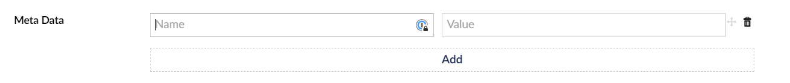

# MetaData Property Editor

The MetaData property editor allows you to add metadata to your product, this is passed over to the Payment Provider.

In the data type picker it is called **UmbCheckout MetaData** (in the eCommerce group). Use the alias `umbCheckoutMetaData` on your product. Editors add rows of Name and Value. It is stored as JSON; MetaData properties from UmbCheckout 1.x are moved to it when the site is upgraded.

The returned type is: `Dictionary<string, string>`


The node key gets added in the Stripe Session service in a key called "nodeKey"


<figure><figcaption></figcaption></figure>

### Programmatically add metadata

You can programmatically add metadata by creating an `IEnumerable<UmbCheckoutMetaData>()` object


```csharp
var metaData = new List<UmbCheckoutMetaData>
{
    new()
    {
        Name = "Dictionary Key 1",
        Value = "Dictionary Value 1"
    },
    new()
    {
        Name = "Dictionary Key 2",
        Value = "Dictionary Value 2"
    }
}
```

