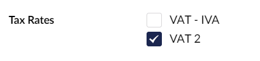

# Tax Rates Property Editor

The Tax Rates property editor allows you to assign a [TaxRate](../../object-reference/taxrate.md) to a product which is used to calculate owed tax during the checkout

In the data type picker it is called **UmbCheckout Tax Rates** (in the eCommerce group). Use the alias `umbCheckoutTaxRates` on your product. Editors pick from a list of the tax rates added in the backoffice, and the value is the list of Stripe tax rate IDs (`IEnumerable<string>`).

* Content editors can use it without access to the Settings section.
* A selected rate that has since been removed stays visible, struck through, as a "(legacy option)".
* On an unlicensed site it shows a message instead, and tax rates aren't sent to Stripe.

<figure><figcaption></figcaption></figure>
